# Statement of Witness

*(CJ Act 1967 s 9, MC Act 1980 ss 5A (3a) and 5B, Criminal Procedure Rules 2015, s16)*

| | |
|---|---|
| **Statement of** | Quoc Anh Luu |
| **Age of Witness** | Over 18 |
| **Occupation of Witness** | Digital Investigator, B.Y.T.E Detective Agency |
| **Case Reference Number** | CPD-2024-04-023 |
| **Police Reference** | CPD-2024-04-023 |

I declare that:

I understand that my overriding duty is to the court and I have complied with, and will continue to comply with, that duty. This report (consisting of 42 pages each signed by me) is true to the best of my knowledge and belief, and I know that if it is introduced in evidence then it would be an offence wilfully to have stated in it anything that I knew to be false or did not believe to be true.

Furthermore, that:

I am an expert in Digital Forensic and I have been requested to provide a statement. I confirm that I have read guidance contained in a booklet known as Disclosure: 'Experts' Evidence and Unused Material' which details my role and documents my responsibilities, in relation to revelation as an expert witness. I have followed the guidance and recognise the continuing nature of my responsibilities of revelation. In accordance with my duties of revelation, as documented in the guidance booklet, I:

- (a) confirm that I have complied with my duties to record, retain and reveal material in accordance with the Criminal Procedure and Investigations Act 1996, as amended;
- (b) have compiled an Index of all material. I will ensure that the Index is updated in the event I am provided with or generate additional material;
- (c) understand that in the event my opinion changes on any material issue, I will inform the investigating officer, as soon as reasonably practicable and give reasons.

Signature: Quoc Anh Luu

---

## Table of Contents

- [Qualifications and Experience](#qualifications-and-experience)
- [Background Information](#background-information)
- [Document Summary](#document-summary)
- [Receipt / Continuity of Items](#receipt--continuity-of-items)
- [Purpose of Examination](#purpose-of-examination)
- [Technical Issues](#technical-issues)
- [Examination](#examination)
  - [Section A: Carved Internal Document (Task 2)](#section-a-carved-internal-document-task-2)
  - [Section B: External Document Examination (Task 3)](#section-b-external-document-examination-task-3)
  - [Section C: Carved Independent JPEG File Examination](#section-c-carved-independent-jpeg-file-examination)
- [Interpretation](#interpretation)
- [Conclusion](#conclusion)
- [Appendix A: Contemporaneous Notes](#appendix-a-contemporaneous-notes)
- [Appendix B: OOXML Examination Exhibits](#appendix-b-ooxml-examination-exhibits)
- [Appendix C: Evidence Timeline Diagram](#appendix-c-evidence-timeline-diagram)
- [Appendix D: Evidence Relationship Diagram](#appendix-d-evidence-relationship-diagram)

---

## Qualifications and Experience

- **Academic qualifications:** Bachelor's degree in Cybersecurity from FPT University, Vietnam. Currently pursuing a Master's degree in Cybersecurity at the University of Southampton, UK.
- **Career history:** 1 year of experience as a SOC Analyst Tier 1 at Viettel CyberSecurity.
- **Length of service:** 1 year
- **Area(s) of expertise (relevant to case):** Digital Forensics, Malware Analysis, and Data Recovery.
- **Frequency that you have reported this evidence type:** This is my first instance of compiling a formal legal report concerning this specific type of recovered digital evidence.

## Background Information

**Details of the allegation:**

- **What:** Over 500 books have been identified as having had pages removed in the same manner across multiple bookshops in Cyberly. The books were damaged by the removal of individual pages, leaving them incomplete. At the time of the investigation, no obvious connection between the books that were targeted had been established by the initial investigating team.
- **When:** The damage is believed to have occurred over a period of approximately three months prior to the arrest of the suspect on 23 April 2024, placing the period of criminal activity between approximately January 2024 and April 2024.
- **Whom:** Dr Taylor Perl Salt was arrested on 23 April 2024 on suspicion of criminal damage. He was identified through CCTV images released during a public appeal and was previously known only by the pseudonym 'The Page Turner'.
- **Where:** The damage was carried out across multiple bookshops in Cyberly. The specific locations affected are not individually named in the material available to this examiner.

**Case circumstances relevant to evidence type being reported:** The Cyberly Police Department established a taskforce named Operation Spoiler to investigate the incidents. Upon Dr Salt's arrest, a search warrant was granted for his property. A novelty Lego-shaped USB stick was discovered hidden inside a Lego model of a bus and was bagged as exhibit SM/2024/04/023/001. The exhibit was sent to the digital investigation unit for forensic examination.

**Details from witness statements:** Eyewitness accounts in Cyberly Chronicles news report titled "Mysterious Bibliomaniac on the Loose in Cyberly" describe a sunny-haired man with a scholarly appearance frequently seen in bookshops and libraries across Cyberly. During police interview CA0014 on 23 April 2024, Dr Salt denied all accusations, admitted visiting libraries, and provided no substantive alibi.

> "The interpretations and conclusions I have drawn in this case are based on information I have received. Should this information change then it may be necessary for me to re-evaluate my findings. If required, this would be most effective in advance of any trial."

## Document Summary

This statement has been prepared in relation to Case Number CPD-2024-04-023, Operation Spoiler, on behalf of the Cyberly Police Department. The following documents were referred to and relied upon during the examination and in forming the conclusions set out in this statement:

The forensic imaging report for exhibit SM/2024/04/023/001, file SM_2024_04_023_001.dd.txt, was provided by the acquiring officer and contains the device information, acquisition timestamps, sector count, and SHA256 hash value used to verify the integrity of the forensic image prior to examination.

The operational case brief for Operation Spoiler, prepared by the Cyberly Police Department, was provided to give context to the investigation and to outline the four points to prove that this examination was asked to address.

Five supplementary documents from the Cyberly world were provided as case material and referred to during the examination: News Article 1 published by Cyberly Chronicles on 23 April 2024; News Article 2 published by Cyberly Chronicles on 23 April 2024; Police Interview transcript CA0014 dated 23 April 2024; the Cyberly University Press Release dated 24 April 2024; and the Puns and Pages Press Release. One additional document, News Article 3 published by Cyberly Chronicles, was identified through the Cyberly Chronicles training site and referred to during the examination.

The police interview transcript CA0014 records the interview conducted by Detective FOSSIL with Dr Taylor Perl Salt on 23 April 2024 and was relied upon for contextual information about the suspect's behaviour and statements.

## Receipt / Continuity of Items

The following item was received for examination:

Exhibit SM/2024/04/023/001, described as a novelty Lego-shaped USB stick, red in colour, was received from the digital investigation unit in the form of a verified forensic disk image.

The forensic image file is named SM_2024_04_023_001.dd and was acquired on 23 April 2024 by the acquiring officer using AccessData FTK Imager version 3.4.2.6 and a Tableau write blocker. The acquisition began at 15:39 and was completed at 15:44 on 23 April 2024. Verification of the image was completed at 15:46 on the same date. The SHA256 hash value of the verified image is:

```
B4F6D02CC850DAC6E6F981B929512309180D1631BE1C1439E6EA9DDEB64B294C
```

The original physical exhibit SM/2024/04/023/001 was described in case notes as having been found inside a Lego model of a bus at the property of Dr Taylor Perl Salt. It was bagged and labelled by the discovering officer at the scene prior to being sent to the digital investigation unit.

No physical items were returned during this examination. The forensic image and all associated documentation were received in good condition with no reported acquisition errors.

## Purpose of Examination

This examination was requested by the Cyberly Police Department in relation to Operation Spoiler, Case Number CPD-2024-04-023. The examination was conducted to assist the investigation into allegations of criminal damage to books across multiple bookshops in Cyberly, in which Dr Taylor Perl Salt has been identified as a suspect.

The Cyberly Police Department and the Mayor of Cyberly requested that the following four points to prove be addressed through this examination:

1. To determine who owns or was using the USB stick identified as exhibit SM/2024/04/023/001.
2. To identify what information exists about the user or users of the USB stick.
3. To identify who Dr Taylor Perl Salt is and what his relationship is to the case and the seized exhibit.
4. To provide any further insight into the reason for the criminal damage carried out on the books across the bookshops of Cyberly.

This examination was conducted by a member of the B.Y.T.E Detective Agency following the reassignment of the case after the initial examination by Detective Waffles McBiscuit was found to have produced insufficient information for a prosecution.

## Technical Issues

The following tools and techniques were used during this examination:

The forensic disk image was examined manually using HxD, a hex editor, to identify and recover files from the unallocated space of the image. This involved searching for known file signatures to locate the start and end points of files and extracting the identified data by hand. No automated carving tools were used at any stage of the data recovery process.

The recovered OOXML document was examined by renaming it with a zip file extension, which allowed direct access to its internal folder structure without the use of specialist software. The internal XML files were then opened and read using XML Marker, a free XML viewing tool, to extract document metadata and identify any content that had been hidden within the file.

---

## Examination

### Section A: Carved Internal Document (Task 2)

#### A.1 Item Description

The item examined is an OOXML document file (.docx format) that was manually carved and recovered from the unallocated space of the forensic disk image SM_2024_04_023_001.dd, which was previously acquired from exhibit SM/2024/04/023/001. Because the file was recovered from raw binary data rather than an intact file system, it does not carry external file system metadata such as MAC timestamps. However, the internal structure of the file was found to be complete and fully functional.

#### A.2 Examination Technique

The document was examined by renaming it with a .zip extension, which allowed direct access to its internal folder structure without using any automated forensic software. Two internal metadata files (`docProps/core.xml` and `docProps/app.xml`) were opened and read using XML Marker to extract document properties. The main body file (`word/document.xml`) was reviewed at source code level to identify any content that had been deliberately hidden. The media folder (`word/media/`) was also inspected for embedded images.

#### A.3 Task 2a: Document Timeline

**Examinations conducted:**

The two metadata files, `docProps/core.xml` and `docProps/app.xml`, were opened and read to identify all available timestamps and editing history recorded inside the document.

**Artefacts found:**

The following values were extracted directly from the metadata files:

| Property | Value | Source File | Exhibit |
|---|---|---|---|
| Creation Date | 2020-07-08 at 15:53 UTC | core.xml | 2.1 |
| Last Printed Date | 2024-04-23 at 13:17 UTC | core.xml | 2.1 |
| Last Modified Date | 2024-04-23 at 13:19 UTC | core.xml | 2.1 |
| Revision Count | 18 | core.xml | 2.1 |
| Total Editing Time | 110 minutes | app.xml | 2.2 |
| Software Used | Microsoft Office Word 16.0 | app.xml | 2.2 |

**Analysis results:**

These values together describe the following document history. The document was first created on 8 July 2020. Over the following four years, it was opened and edited 18 times, totaling 110 minutes of active editing time. On 23 April 2024, the document was printed at 13:17 UTC and then saved for the final time at 13:19 UTC, just two minutes later. This is the same date that Dr. Taylor Perl Salt was arrested. The very short gap between the print and save events on the day of arrest suggests the document was being actively reviewed or finalized at that time. The document timestamps identified above are presented visually in the Evidence Timeline Diagram at [Appendix C](#appendix-c-evidence-timeline-diagram) [3], which highlights these final interactions within the broader chronological sequence of the investigation.

#### A.4 Task 2b: Linkage to Individual

**Examinations conducted:**

The `core.xml` file was read to identify the recorded author and last editor of the document. The source code of `word/document.xml` was then reviewed line by line to look for any text that had been hidden using formatting tricks rather than standard deletion.

**Artefacts found:**

From `core.xml`, the following author fields were identified:

| Property | Value | Source File | Exhibit |
|---|---|---|---|
| Original Creator | Marsha Lowe | core.xml | 2.3 |
| Last Modified By | Taylor Salt | core.xml | 2.3 |

From the source code of `word/document.xml`, a series of text strings were found hidden using white font colour (recorded in the XML as `w:color w:val="FEFFFF"`, which renders as invisible white text on a white background) [2.4]. These strings were scattered individually across different paragraph endings throughout the document. When read in sequence, they form the phrase: **"Dr Taylor Salt Was Here And here"** [2.5].

**Analysis results:**

The document metadata directly records Taylor Salt as the last person to modify the file. This is supported by the hidden signature found inside the document body, which spells out his full name and title. The use of white-on-white formatting to hide this text shows that this was done intentionally, suggesting the author was aware the document might be examined and chose to leave a concealed mark rather than a visible one.

#### A.5 Task 2c: Further Information on Dr Salt

**Examinations conducted:**

The `word/media/` directory inside the extracted archive was inspected to identify all image files stored within the document. File extensions were checked against the actual binary content of each file, and the images were then reviewed visually and cross-referenced against Cyberly-specific open-source material from the B.Y.T.E Detective Agency website.

**Artefacts found:**

Three image files were found in `word/media/`. Two of these files had their extensions deliberately altered to disguise their true format [2.6], which is a technique used to prevent automated scanning tools from correctly identifying them. After manually restoring the correct file extensions, all three images were readable. Cross-referencing with the B.Y.T.E Detective Agency Cyberly [2.10] records identified image11.png [2.7] as Detective Lord Pixelington and image12.png [2.8] as HR Manager Gloria Gigglesworth, both members of the investigative agency. The remaining file, image13.png [2.9], did not match any agency staff member.

**Analysis results:**

Through a process of elimination, image13.png is identified as the portrait of Dr. Taylor Salt. The presence of agency staff photographs inside the suspect's document, combined with the deliberate file extension tampering, suggests that Dr. Salt had been gathering information about the investigators assigned to the case.

#### A.6 Task 2d: Insight into Motive

**Examinations conducted:**

The subject, keywords, and description fields from `core.xml` were reviewed. The full source code of `word/document.xml` was then examined for any additional hidden content, with particular attention to white-formatted text blocks and any table structures that appeared to contain non-visible data. The `word/media/` directory was also reviewed for any instructional or planning materials.

**Artefacts found:**

From `core.xml`, the following fields contained notable content:

| Property | Value | Source File | Exhibit |
|---|---|---|---|
| Subject | "How to create a famous science fiction book from many other books by stealing [deleted]" | core.xml | 2.11 |
| Keywords | "from each book and using stickytape and maybe a stapler to put it all back together again" | core.xml | 2.11 |

From `word/document.xml`, the following hidden text blocks were recovered:

- **Operation name and goal:** "Operation penguinontheloose in about creating a alternative fiction book out of page 42 from a lot of books." [2.12]
- **Step instruction:** "STEP 3 is very clear, look to Douglas A and answer the question about the universe, the answer is 42!" [2.13]
- **Reflective comments** [2.14]:
  - "Do you think anyone reads documents? I reckon you could remove a page, and no one would notice."
  - "If we always removed the same page, I wonder."
  - "What story it would create?"
- **Steganography hint:** "If you put white text on white paper, what happens" [2.15]
- **Additional clue note:** "For additional reference it isn't 42 factorial, it's just 42, but I like ! at the end of things" [2.15]

A hidden table was also found in `document.xml`, with all text formatted in white. The table contained the following text when extracted: "My evil plan / To create a book from books / Is nearly complete / Or is it / I wonder what the pattern is / Well, ok I know / But in case you find this / I'm not telling you / Only, I already have told you / Ooooo what a mean clue / You will never guess." [2.16]

From `word/media/`, an image was found containing a visual plan titled 'operation penguinontheloose' [2.17]. The image sets out the following steps:

- Step 1: Find 42 libraries
- Step 2: In each library, locate 42 books in empty corridors
- Step 3: *[absent from the image, deliberately omitted]*
- Step 4: Remove page 42 from each book
- Step 5: Complete operation penguinontheloose
- Step 6: Win best alternative fiction book at Southampton Literary Festival

**Analysis results:**

The Subject and Keywords fields from `core.xml`, when read in sequence, form a complete description of the method: the Subject field records the goal of taking content from multiple books by stealing, and the Keywords field records the physical reassembly method using stickytape and a stapler.

The operation image from `word/media/` sets out a structured six-step plan titled 'operation penguinontheloose'. Step 3 is absent from the image but is partially resolved by the hidden text in `word/document.xml` stating: 'STEP 3 is very clear, look to Douglas A and answer the question about the universe, the answer is 42.' This identifies the number 42 as central to the plan; the instruction remains indirect and requires interpretation of the cultural reference rather than being an explicit instruction. Step 4, explicitly stated as 'remove page 42 from each book', is the step that most directly describes the criminal act. Step 6 records the end goal as winning the best alternative fiction book at Southampton Literary Festival, confirming the page collection was directed toward a specific competitive objective.

The hidden text 'Operation penguinontheloose in about creating a alternative fiction book out of page 42 from a lot of books' is consistent with the six-step plan in the image and confirms that the document's author had direct knowledge of the operation name, method, and objective.

The three reflective comments recovered from `word/document.xml`, when read in sequence, document a progression of thought: 'Do you think anyone reads documents? I reckon you could remove a page, and no one would notice', followed by 'If we always removed the same page, I wonder', and 'What story it would create?' These statements progress from the initial idea of removing a page undetected to the consideration of removing the same page consistently across multiple books, to the anticipated outcome of that activity. This sequence confirms the author had actively reasoned through the concept and its potential outcome within the document itself.

The hidden table, identified through source code inspection and formatted entirely in the color FEFFFF, contains the text 'My evil plan / To create a book from books / Is nearly complete', indicating the author's awareness that the activity constituted wrongdoing. The additional clue note 'For additional reference it isn't 42 factorial, it's just 42' further confirms that the number 42 was a deliberate and specific choice within the plan rather than an approximate or general reference.

The consistent application of white-on-white formatting across multiple locations within the document body and the hidden table, combined with the steganography hint 'If you put white text on white paper, what happens', indicates the author was not only aware of the concealment technique being used but had embedded an acknowledgement of it directly within the document. This suggests the concealment was deliberate and systematic rather than incidental.

### Section B: External Document Examination (Task 3)

#### B.1 Items Description

The external sources examined in this section consist of six documents obtained from Cyberly-specific sources as part of the wider case investigation. These documents were not recovered from the seized exhibit but were provided as supplementary case material and Cyberly world resources. The items examined are as follows:

| Item | Description | Date |
|---|---|---|
| News Article 1 | Cyberly Chronicles news report titled "Mysterious Bibliomaniac on the Loose in Cyberly" | 23 April 2024 |
| News Article 2 | Cyberly Chronicles offbeat news report titled "The Great Balloon Zoo Escapade" | 23 April 2024 |
| Police Interview CA0014 | Transcript extract of interview conducted at Cyberly Police Department between Detective FOSSIL and Dr. Taylor Perl Salt | 23 April 2024 |
| Press Release (Cyberly University) | Official communication from Cyberly University Office of Communications announcing an award for Dr. Taylor Perl Salt | 24 April 2024 |
| Press Release (Puns & Pages) | Press release from bookshop "Puns & Pages" announcing an upcoming book launch by anonymous author B.B. Leaks | Undated |
| News Article 3 | Cyberly Chronicles news article titled "The Answer is 42 Pages! Win 10 Million Cyberly Pounds for Your Novel Idea!" announcing The Great Cyberly Fiction Challenge | 24 February |

#### B.2 Examination Technique

Each external document was read in full, and its content was manually cross-referenced against the artefacts recovered during the internal document examination in Section A. The examination focused on identifying information within these sources that corroborates, contradicts, or adds context to the findings already established from the carved OOXML document. News Article 2 was reviewed but found to contain no information relevant to the case circumstances and is not referenced further in this section.

#### B.3 Task 3a: External Corroboration of Document Timeline

**Examinations conducted:**

The Police Interview transcript CA0014 and News Article 1 were reviewed to identify any timestamps or event references that could be placed alongside the document timeline established in Task 2a.

**Artefacts found:**

| Property | Value | Source |
|---|---|---|
| Interview date | 23 April 2024 | Police Interview CA0014 |
| Interview start time | 14:00 hours | Police Interview CA0014 |
| Interview location | Interview Room 2, Cyberly Police Department | Police Interview CA0014 |
| Persons present | Detective FOSSIL, Dr. Taylor Perl Salt, Officer Byte | Police Interview CA0014 |
| Article publication date | 23 April 2024 | News Article 1 |
| Article content | Public appeal reporting a suspect known as The Page Turner, active at bookshops | News Article 1 |
| Investigating officer named | Detective FOSSIL leading investigation at time of publication | News Article 1 |

**Analysis results:**

The interview transcript records a time of 14:00 hours on 23 April 2024, placing Dr Taylor Perl Salt at Cyberly Police Department on that date. News Article 1 was published on the morning of 23 April 2024, reporting a public appeal about a suspect known as The Page Turner who had been seen at bookshops across Cyberly. Cross-referencing the publication of News Article 1 with the document timestamps from Task 2a produces the following sequence of events on that date:

| Time | Event | Source |
|---|---|---|
| Morning 23 Apr 2024 | News Article 1 published reporting The Page Turner | News Article 1 |
| 13:17 UTC | Document last printed | core.xml |
| 13:19 UTC | Document last saved | core.xml |
| 14:00 UTC | Police interview started | Police Interview CA0014 |
| 15:39 UTC | Disk image acquisition started | Imaging report |
| 15:44 UTC | Disk image acquisition completed | Imaging report |

The publication of News Article 1 on the morning of 23 April 2024 establishes that a public notice identifying the suspect as The Page Turner was in circulation before the document was printed and saved that afternoon. The document was printed at 13:17 UTC and saved at 13:19 UTC, just two minutes apart, and approximately one hour before the time recorded on the police interview transcript. It is noted that the sequence of these events is consistent with a scenario in which the individual associated with the document became aware of being discovered by the public's awareness and took steps to finalise or modify the document shortly before being arrested and interviewed by police. However, this observation is offered as a contextual inference rather than a confirmed finding, as the exact time of the News Article 1 publication within the morning of 23 April 2024 is not recorded in the available evidence. The acquisition of the disk image later that afternoon confirms the device was seized on the same day these final document interactions occurred. The full chronological sequence is presented visually in the Evidence Timeline Diagram at [Appendix C](#appendix-c-evidence-timeline-diagram) [3].

#### B.4 Task 3b: External Corroboration of Individual Identity

**Examinations conducted:**

News Article 1 and the Police Interview transcript CA0014 were reviewed for any references to the identity of the individual associated with the carved OOXML document.

**Artefacts found:**

| Artefact | Value | Source |
|---|---|---|
| Suspect name confirmed | Dr. Taylor Perl Salt | Police Interview CA0014 |
| Pseudonym used publicly | "The Page Turner" | News Article 1 |
| Physical description | Sunny-haired man with an amused twinkle in his eye, scholarly aura, mirthful demeanour | News Article 1 |
| Clothing reference | A designer blue jumper was purchased the day before the arrest | Police Interview CA0014 |
| Personality | "a man whose mirthful demeanor belies a secretive streak, whose scholarly aura is shadowed by a penchant for puzzling pranks." | News Article 1 |

**Analysis results:**

The name Taylor Salt recorded in the `cp:lastModifiedBy` field of the OOXML document is directly corroborated by the Police Interview transcript CA0014, which confirms Dr. Taylor Perl Salt was present and interviewed as a suspect on the same date the document was last modified.

The physical description recorded in News Article 1, specifically a sunny-haired man with an amused twinkle in his eye and a mirthful demeanor, is visually consistent with the portrait recovered as image13.png from the OOXML document's `word/media/`, which depicts a blonde-haired individual with a broad smile. During police interview CA0014, Dr Salt himself stated that he had purchased a designer blue jumper the day before his arrest. The portrait in image13.png depicts the subject wearing a blue jumper, providing a direct point of consistency between the portrait stored on the seized device and Dr Salt's own statement.

The personality description recorded in News Article 1 as 'a man whose mirthful demeanor belies a secretive streak, whose scholarly aura is shadowed by a penchant for puzzling pranks' is consistent with the behavior recorded in police interview CA0014, in which Dr Salt consistently deflected direct questions with humor without providing any substantive alibi.

#### B.5 Task 3c: External Information on Dr Salt

**Examinations conducted:**

The Cyberly University Press Release and the Police Interview transcript CA0014 were reviewed to identify any information that provides further detail on Dr Salt's identity, professional background, behaviour, and activities around the time of the alleged offences.

**Artefacts found:**

| Artefact | Value | Source |
|---|---|---|
| Occupation | Faculty member, Cyberly University | Cyberly University Press Release |
| Specialisation | Literary analysis and digital archiving | Cyberly University Press Release |
| Award received | Golden Bookmark Award for contributions to Literary Science | Cyberly University Press Release |
| Planned public lecture | "The Future of Fiction: Ballooning Ideas in Literature" is scheduled for 2 May 2024 at Cyberly University | Cyberly University Press Release |
| Behaviour during the interview | Evasive, deflecting direct questions with humour, no substantive alibi provided | Police Interview CA0014 |
| Interest in balloon animals | "Libraries? I only go there for the balloon animals. You haven't lived until you've seen a balloon pterodactyl perched on a thesaurus." | Police Interview CA0014 |

**Analysis results:**

The Cyberly University Press Release confirms that Dr Salt holds a faculty position at Cyberly University, specializing in literary analysis and digital archiving. His receipt of the Golden Bookmark Award for contributions to Literary Science establishes him as a recognised figure within the Cyberly literary community.

Dr Salt's planned public lecture titled 'The Future of Fiction: Ballooning Ideas in Literature' was scheduled for 2 May 2024 at Cyberly University, 9 days after his arrest on 23 April 2024. No information within the available case material confirms that Dr Salt was released from custody following his interview, and no evidence is available to confirm whether this event took place as scheduled.

During police interview CA0014, Dr Salt admitted to visiting libraries and expressed a specific interest in balloon animals, stating, 'Libraries? I only go there for the balloon animals. You haven't lived until you've seen a balloon pterodactyl perched on a thesaurus.' While this statement was made in a humorous context, it confirms his familiarity with library environments. Throughout the interview, Dr Salt consistently deflected direct questions with humor and did not provide any substantive alibi, which is consistent with the personality description recorded in News Article 1 as 'a man whose mirthful demeanor belies a secretive streak'.

#### B.6 Task 3d: External Insight into Motive

**Examinations conducted:**

News Article 1, the Police Interview transcript CA0014, the Puns & Pages Press Release, the Cyberly University Press Release, and News Article 3 were reviewed to identify any information from external sources that provides further insight into Dr Salt's role in the criminal damage of the books.

**Artefacts found:**

| Artefact | Value | Source |
|---|---|---|
| Competition name | The Great Cyberly Fiction Challenge | News Article 3 |
| Prize value | 10 million Cyberly Pounds | News Article 3 |
| Submission requirement | Exactly 42 pages, no more and no less | News Article 3 |
| Disqualification rule | Submissions of 41 or 43 pages are instantly disqualified | News Article 3 |
| Organiser | Cyberly Arts and Literature Council | News Article 3 |
| Content requirement | Highly original, humorous and surreal fiction | News Article 3 |
| Book title | "The Mysterious Misadventures of Bartholomew Blondelocks and the Balloon Animal" | Puns & Pages Press Release |
| Author pen name | B.B. Leaks (anonymous) | Puns & Pages Press Release |
| Planned book launch date | 1 May 2024 at Cyberly's Grandiose Book Emporium | Puns & Pages Press Release |
| Implied identity of B.B. Leaks | "Could the anonymous B.B. Leaks be the infamous Dr. ... no, that would be telling!" | Puns & Pages Press Release |
| Physical clue in the manuscript | A tuft of blond hair found in the manuscript | Puns & Pages Press Release |
| Planned public lecture | "The Future of Fiction: Ballooning Ideas in Literature" scheduled for 2 May 2024 | Cyberly University Press Release |
| Suspect description at the scene | Sunny-haired man, often wandering the aisles, pseudonym "The Page Turner" | News Article 1 |
| Statement about the crime location | "If I were to commit a crime, it wouldn't be in the non-fiction aisle. Too many witnesses. The biographies always have eyes on you." | Police Interview CA0014 |

**Analysis results:**

News Article 3 provides the most significant external corroboration of motive identified in this investigation. The Great Cyberly Fiction Challenge, announced by the Cyberly Arts and Literature Council, offers a prize of 10 million Cyberly Pounds for the most original, humorous, and surreal fiction submission. The competition requires entrants to submit exactly 42 pages, with submissions of any other page count resulting in immediate disqualification. This specific requirement directly explains why page 42 was consistently targeted across the books damaged in Cyberly. The number 42 was not an arbitrary choice within the operation plan recovered from `word/media/` during Task 2d but reflects the precise submission requirement of a publicly announced and financially significant competition.

The Puns & Pages Press Release announces a book titled 'The Mysterious Misadventures of Bartholomew Blondelocks and the Balloon Animal', authored by the anonymous B.B. Leaks, scheduled for launch on 1 May 2024, 8 days after Dr Salt's arrest on 23 April 2024. The press release implies the author's identity is Dr Salt through the phrase 'Could the anonymous B.B. Leaks be the infamous Dr. ... no, that would be telling.' A tuft of blond hair found in the manuscript provides a physical detail consistent with the physical description of Dr Salt as a sunny-haired man recorded in News Article 1. The proximity of the planned launch date to the date of arrest suggests the manuscript was in a completed or near-completed state at the time Dr Salt was taken into custody, which is consistent with Step 5 of the operation plan: 'Complete operation penguinontheloose.'

The Cyberly University Press Release records that Dr Salt's planned public lecture titled 'The Future of Fiction: Ballooning Ideas in Literature' was scheduled for 2 May 2024, one day after the planned book launch. The consecutive scheduling of these two public events suggests a coordinated public strategy rather than two coincidental engagements, with the lecture potentially serving as a platform to promote the newly launched work under an academic context.

News Article 1 records eyewitness accounts of a sunny-haired man frequently wandering the aisles of bookshops and libraries in Cyberly, operating under the pseudonym 'The Page Turner'. The pseudonym itself directly describes the act of removing pages from books. During police interview CA0014, Dr Salt stated, 'If I were to commit a crime, it wouldn't be in the non-fiction aisle. Too many witnesses. The biographies always have eyes on you.' This statement demonstrates a specific awareness of library layouts and the importance of selecting locations with minimal witness presence, which is directly consistent with Step 2 of the operation plan recovered from `word/media/`, which specifies locating books in empty corridors.

### Section C: Carved Independent JPEG File Examination

**Examinations conducted:**

The full disk image was scanned manually using HxD hex editor for the standard JPEG header signature `FF D8 FF`. All candidate results were evaluated against three identification criteria: row position alignment, cluster boundary divisibility, and data boundary validation. An independent JPEG file was identified and carved.

**Artefacts found:**

| Artefact | Value | Exhibit |
|---|---|---|
| Image content | AI-generated illustration of multiple library and bookshop interiors | Figure 2. carved_image_2.jpeg |

**Analysis results:**

The carved JPEG file depicts an AI-generated illustration of multiple library and bookshop interiors rendered in a cartoon style. The content of this image is directly consistent with the case circumstances, as the investigation concerns criminal damage carried out across bookshops and libraries in Cyberly. The image depicts the type of environment described in the case brief, as the locations where pages were removed from books. The full carving process, including offset calculations and hex editor screenshots, is documented in [Appendix A](#appendix-a-contemporaneous-notes).

---

## Interpretation

### The Origin of the Plan

The examination of the carved OOXML document reveals that it was created by an individual named Marsha Lowe in July 2020. At some point over the following four years, the document passed into the hands of Taylor Salt, who is recorded as the last person to modify it. Over 18 separate editing sessions, accumulating 110 minutes of active editing time, the document was transformed from its original purpose into a vehicle for concealing a detailed criminal plan. It is my opinion that the choice to hide this plan within an existing document about the importance of libraries and economic recovery was not accidental. The subject matter of the host document provided a degree of cover for the hidden content, as anyone casually reading the file would encounter what appeared to be a straightforward economic report.

### The Motive

The Great Cyberly Fiction Challenge, announced by the Cyberly Arts and Literature Council and reported in News Article 3, offers a prize of 10 million Cyberly Pounds for the most original fiction submission. The competition requires entrants to submit exactly 42 pages; any other page count results in immediate disqualification. This competition provides the clearest and most specific explanation for the criminal damage carried out across the bookshops in Cyberly. Number 42 appears consistently throughout the hidden content of the document, the operation image recovered from the document's media folder, and the hidden text referencing 'Douglas A and the answer to the question about the universe'. Far from being arbitrary, 42 was the precise page count required to enter and win a competition worth 10 million Cyberly Pounds. Dr Salt, a recognized figure in the Cyberly literary community and recipient of the Golden Bookmark Award for contributions to Literary Science, had both the knowledge and the motivation to pursue such a goal.

### The Blueprint

The operation image recovered from the document's media folder sets out a structured six-step plan titled 'operation penguinontheloose'. The plan describes finding 42 libraries, locating 42 books in empty corridors within each library, removing page 42 from each book, and ultimately winning the best alternative fiction book at Southampton Literary Festival. Step 3 is deliberately absent from the image. Hidden text within the document resolves this gap, instructing the reader to look to 'Douglas A' and identify the answer as 42. It is my opinion that the deliberate omission of Step 3 from the visual plan, combined with its concealment as an indirect cultural reference, shows that the author was aware of the incriminating nature of that specific instruction and took deliberate steps to separate it from the rest of the plan.

### The Execution

News Article 1 records eyewitness accounts of a sunny-haired man with a scholarly appearance and a cheerful demeanor, frequently seen wandering the aisles of bookshops and libraries across Cyberly under the pseudonym 'The Page Turner'. The pseudonym itself directly describes the act of removing pages from books. During police interview CA0014, Dr Salt admitted to visiting libraries and made the notable statement that if he were to commit a crime, it would not be in the non-fiction aisle because there were too many witnesses, and that biographies always have eyes on you. This statement demonstrates a specific awareness of library layouts and the importance of selecting locations with minimal witness presence. This is directly consistent with Step 2 of the operation plan, which specifies locating books in empty corridors. The physical description of the suspect in News Article 1, including sunny hair and a scholarly aura, is consistent with the portrait recovered from the document's media folder, which depicts a blonde-haired individual wearing a blue jumper. Dr Salt himself referenced purchasing a designer blue jumper the day before his arrest, providing a direct and self-corroborating link between the portrait stored on the seized device and the identified suspect.

### The Cover-up

Throughout the document, Dr Salt applied a consistent technique of hiding sensitive content using white-coloured text on a white background, rendering it invisible under normal reading conditions. This technique was applied across multiple locations within the document body and within a hidden table, indicating that the concealment was systematic and deliberate rather than accidental. The document even contains a self-referencing hint about this technique, with the hidden text asking, 'If you put white text on white paper, what happens.' The hidden table contains the text 'My evil plan, to create a book from books, is nearly complete', and another hidden comment asks 'Do you think anyone reads documents? I reckon you could remove a page, and no one would notice.' It is my opinion that these comments demonstrate not only that the author was fully aware the activity was criminal, but that he was confident the concealment techniques would be sufficient to prevent discovery. The hidden signature spelling 'Dr Taylor Salt Was Here' presents an interesting contradiction: the author took extensive steps to conceal the plan yet still chose to embed his name and title within the document, suggesting a degree of confidence that borders on deliberate provocation.

### The Brand Building Campaign

It is noted that balloon animals appear as a recurring theme across multiple independent sources examined in this investigation. On 23 April 2024, the same date as Dr Salt's arrest, an anonymous balloon zoo installation appeared in Cyberly's central park. The installation was attributed to an anonymous artist known only as 'Puff the Magic Inflater' and featured balloon dachshunds as its centerpiece. The Puns and Pages Press Release, announcing the book attributed to the anonymous author B.B. Leaks, places a balloon animal dog at the centre of the story as the protagonist's key companion. The specific shared motif of balloon animal dogs between these two events, combined with the anonymous nature of both, and the consistent whimsical and humorous tone that runs across both sources, may suggest that the balloon zoo installation formed part of a coordinated effort to build public familiarity with the balloon animal theme in advance of the planned book launch on 1 May 2024. It is further noted that Dr Salt, throughout this case, appears to have operated under multiple anonymous characters, including 'The Page Turner', the implied pen name B.B. Leaks, and potentially 'Puff the Magic Inflater', all of which share the same playful and humorous character consistent with his personality as described across multiple sources. These observations are offered as contextual inferences and are not relied upon as confirmed findings.

### The End Game

The Puns and Pages Press Release announce the planned launch of a book titled 'The Mysterious Misadventures of Bartholomew Blondelocks and the Balloon Animal' on 1 May 2024, eight days after Dr Salt's arrest. The press release implies the author's identity is Dr Salt through the phrase 'Could the anonymous B.B. Leaks be the infamous Dr. ... no, that would be telling.' A tuft of blond hair found in the manuscript provides a physical detail consistent with the description of Dr Salt as a sunny-haired man recorded in News Article 1. The following day, 2 May 2024, Dr Salt was scheduled to deliver a public lecture at Cyberly University titled 'The Future of Fiction: Ballooning Ideas in Literature'. It is my opinion that the consecutive scheduling of these two public events was not coincidental and that the lecture was intended to serve as an academic platform to promote the newly launched work. The document was last saved at 13:19 on 23 April 2024, the same day as Dr Salt's arrest. No information within the available case material confirms that Dr Salt was released from custody following his interview, and no evidence is available to confirm whether either planned event took place. It is my opinion that Dr Salt was in the final stages of completing his plan at the time of his arrest, and that the criminal damage carried out across the bookshops of Cyberly was nearing its intended conclusion.

### Opinion on Prosecution and Defence

Having considered all of the evidence examined in this investigation, it is my opinion that the scientific results obtained overall support the version of events presented by the prosecution more strongly than the defence.

The evidence supporting the prosecution includes the following. The document metadata directly records Taylor Salt as the last person to modify the file. A hidden digital signature spelling 'Dr Taylor Salt Was Here' was found embedded within the document body, confirming that the individual associated with the document was aware of its contents. The operation plan recovered from the document's media folder describes in specific detail the method and objective of the criminal damage. The competition requirement of exactly 42 pages provides a clear and financially motivated explanation for why page 42 was consistently targeted. The physical description of the suspect from News Article 1, the portrait recovered from the document, and Dr Salt's own reference to a blue jumper during his police interview together form a consistent and mutually corroborating chain of identity evidence. Dr Salt's statement about avoiding the non-fiction aisle due to too many witnesses demonstrates awareness of detection avoidance that is directly consistent with the operation plan.

The evidence that may support the defence includes the following. The document was created by Marsha Lowe and not by Dr Salt, which leaves open the question of how and when Dr Salt came to possess it. No witness directly observed Dr Salt removing pages from books. The identity of B.B. Leaks has not been formally confirmed as Dr Salt. Dr Salt denied all accusations during his police interview. No direct evidence places Dr Salt at the balloon zoo incident.

In my opinion, while the defence points noted above cannot be excluded, the combination of document metadata, the hidden signature, the detailed operation plan, the external competition motive, and the consistent pattern of anonymous behavior across multiple sources provides a strong basis for the prosecution's position. The evidence is consistent with a planned, deliberate, and financially motivated course of criminal damage carried out by Dr Taylor Perl Salt across the bookshops and libraries of Cyberly.

The connections between all pieces of evidence discussed in this section are presented visually in the Evidence Relationship Diagram in [Appendix D](#appendix-d-evidence-relationship-diagram) [4]. The diagram groups the evidence into five clusters showing the physical evidence chain, the internal document evidence, the identity corroboration, the motive connections, and the location links. The most significant finding shown in the diagram is that multiple independent sources, including internal document records, external press releases, police interview records, and eyewitness accounts, all point to Dr Taylor Perl Salt as the individual associated with the seized device and the criminal damage carried out across the bookshops of Cyberly.

---

## Conclusion

- The examination was carried out in response to four points raised by the Cyberly Police Department related to the case report: who owns or was using the USB stick; what information exists about the user; who is Dr Taylor Perl Salt and what is his relationship to the case; and what further insight can be provided into the reason for the criminal damage of the books.

- **In relation to the first point**, the forensic examination of the disk image acquired from exhibit SM/2024/04/023/001 recovered an OOXML document from unallocated space. The internal metadata of this document records Taylor Salt as the last person to modify the file on 23 April 2024, the same date the device was seized. A hidden digital signature spelling 'Dr Taylor Salt Was Here' was also found embedded within the document body. Together, these findings indicate that Dr Taylor Perl Salt was the last known user of the USB stick.

- **In relation to the second point**, the document metadata records Dr Salt as having last modified the file at 13:19 UTC on 23 April 2024, just 41 minutes before his police interview was recorded. The document had been edited 18 times over four years, accumulating 110 minutes of active editing time. The portrait recovered from the document's media folder depicts a blonde-haired individual wearing a blue jumper, which is consistent with both the eyewitness description of the suspect in News Article 1 and Dr Salt's own reference to a blue jumper during his police interview. External sources confirm that Dr Salt is a faculty member at Cyberly University, specializing in literary analysis and digital archiving, and the recipient of the Golden Bookmark Award for contributions to Literary Science.

- **In relation to the third point**, Dr Taylor Perl Salt is an established academic at Cyberly University with a professional background in literary analysis. He was identified as a suspect through CCTV images released during a public appeal and was arrested on 23 April 2024. During his police interview, he denied all accusations and provided no substantive alibi. His name is directly recorded in the internal metadata of the document recovered from the seized USB stick, and a hidden signature bearing his full name and title was found concealed within the document body using white-on-white text formatting.

- **In relation to the fourth point**, the hidden content recovered from the document describes a structured plan titled 'operation penguinontheloose', which involved visiting 42 libraries, locating 42 books in empty corridors, and removing page 42 from each book. The stated goal of the plan was to win best alternative fiction book at Southampton Literary Festival. This plan is directly supported by the Great Cyberly Fiction Challenge reported in News Article 3, which offers a prize of 10 million Cyberly Pounds for a fiction submission of exactly 42 pages. The subject field of the document records the goal as taking content from multiple books by stealing, and the keywords field describes the physical method of reassembly using stickytape and a stapler. An independent JPEG file recovered from the same disk image depicts multiple library and bookshop interiors, which is consistent with the locations described in the operation plan.

- **Overall**, the evidence examined in this investigation reveals a planned, deliberate, and financially motivated course of criminal damage carried out by Dr Taylor Perl Salt across the bookshops and libraries of Cyberly, with the intent of assembling a 42-page fiction manuscript for submission to a literary competition worth 10 million Cyberly Pounds.

Signature: Quoc Anh Luu

---

## Appendix A: Contemporaneous Notes

### Task 1

#### a. What is the likely cluster size of this disk? Justify your answer, and show your working.

The most likely cluster size for the disk image SM_2024_04_023_001.dd is **4096 bytes**.

Here is the breakdown of the process to identify the cluster size value.

The applied method is cluster alignment calculation based on the starting positions (heading offsets) of independent files.

- According to the principles of file system space allocation, a complete and independent file (not embedded within another file) is always stored starting from the first byte of a cluster. Therefore, the starting position (Heading Offset) of an independent file must be strictly divisible by (i.e., a multiple of) the actual cluster size.
- In forensic practice for small-capacity drives, potential cluster sizes are typically powers of 2, including common values: 512, 1024, 2048, 4096, or 8192 bytes. By identifying the Heading Offsets and dividing them by these potential values, the original cluster size of the disk can be deduced.

When the unallocated space lacks partition structure due to deletion or corruption, the only way to locate Heading Offsets is to scan the entire drive for fixed binary-level "magic numbers" (hexadecimal signatures).

- To accurately identify these hex strings, the standard forensic database, Gary Kessler's File Signature Library, was utilized for cross-reference:
  - For the JPEG image format, the hexadecimal signature identifying the file header is `FF D8 FF`.
  - For the OOXML document format (Word/Excel/ZIP), the identifying hexadecimal signature is `50 4B 03 04`.
- Using a Hex Editor analysis tool (HxD), these hex values were searched (using the 'Search All' function) across the entire disk image to locate all potential starting points for these two file types.

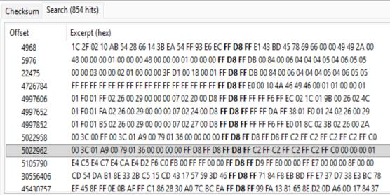

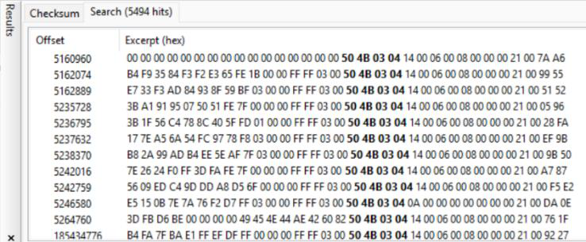

The initial hex string search in the analysis tool typically returns thousands of hits (e.g., 853 hits for JPEG and over 5400 hits for OOXML).

To accurately isolate the Heading Offsets of truly independent files (excluding embedded/junk files), a 3-step verification process was applied:

1. **Visual Alignment:** In the 16-byte/row display interface of the Hex Editor, a file starting at a cluster boundary will always reside in the leftmost column (meaning the Offset ends with the digit 0). Hits floating in the middle of a row were immediately discarded as they represent embedded files.
2. **Data Boundary Check:** The data immediately preceding the Header must indicate the end of a previous block of information. Only results with padding/slack space containing entirely `00` or `FF` bytes immediately before the header were retained for analysis.
3. **Contextual Validation:** The Decoded Text column was examined to ensure the file possesses a valid internal structure (e.g., the string `JFIF` must appear after a JPEG header, or `[Content_Types].xml` must appear immediately after an OOXML header).

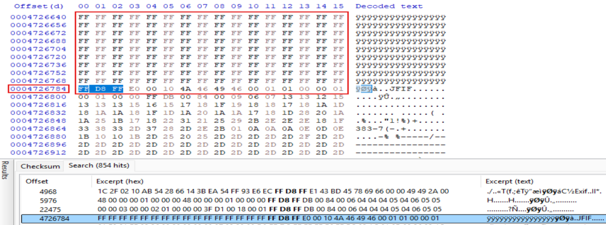

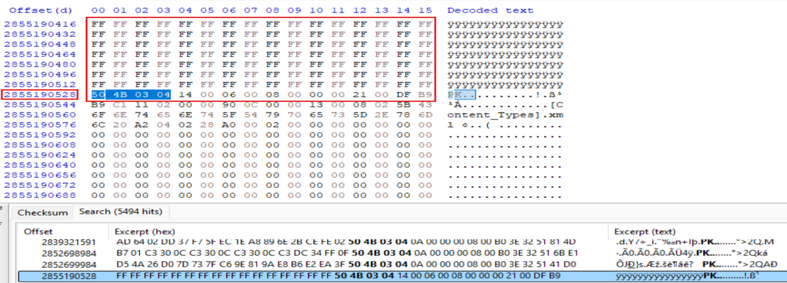

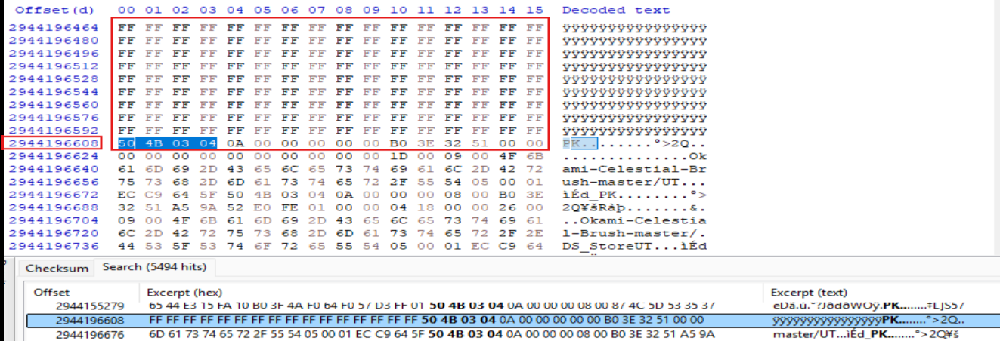

Following the filtering process, 3 potential independent Heading Offsets satisfying all criteria were identified:

- File 1 (JPEG): Decimal Offset 4726784
- File 2 (OOXML): Decimal Offset 2855190528
- File 3 (OOXML): Decimal Offset 2944196608

To prove an Offset genuinely belongs to an independent file and to determine potential cluster sizes, cluster alignment calculations were performed (dividing the Heading Offset by potential cluster sizes).

**File 1 (JPEG at Offset 4726784):**

| File Starting Offset | Potential Cluster Size | = Offset / Cluster Size | Potential Match? |
|---|---|---|---|
| 4726784 | 512 | 9232 | Yes! (Whole number) |
| 4726784 | 1024 | 4616 | Yes! (Whole number) |
| 4726784 | 2048 | 2308 | Yes! (Whole number) |
| 4726784 | 4096 | 1154 | Yes! (Whole number) |
| 4726784 | 8192 | 577 | Yes! (Whole number) |

**File 2 (OOXML at Offset 2855190528):**

| File Starting Offset | Potential Cluster Size | = Offset / Cluster Size | Potential Match? |
|---|---|---|---|
| 2855190528 | 512 | 5576544 | Yes! (Whole number) |
| 2855190528 | 1024 | 2788272 | Yes! (Whole number) |
| 2855190528 | 2048 | 1394136 | Yes! (Whole number) |
| 2855190528 | 4096 | 697068 | Yes! (Whole number) |
| 2855190528 | 8192 | 348534 | Yes! (Whole number) |

**File 3 (OOXML at Offset 2944196608):**

| File Starting Offset | Potential Cluster Size | = Offset / Cluster Size | Potential Match? |
|---|---|---|---|
| 2944196608 | 512 | 5750384 | Yes! (Whole number) |
| 2944196608 | 1024 | 2875192 | Yes! (Whole number) |
| 2944196608 | 2048 | 1437596 | Yes! (Whole number) |
| 2944196608 | 4096 | 718798 | Yes! (Whole number) |
| 2944196608 | 8192 | 359399 | Yes! (Whole number) |

Although the calculation table shows that the identified file starting offsets are divisible by multiple potential cluster sizes (512, 1024, 2048, 4096, and 8192 bytes), 4096 bytes is the most likely cluster size based on the following two lines of reasoning.

- **First**, the physical characteristics of the device were consulted to narrow down the possibilities. The imaging report records a noted capacity of 8 GB based on open-source intelligence findings. However, the actual size of the USB, as confirmed during acquisition, is 3880 MB, calculated directly by multiplying the sector count of 7,946,240 by 512 bytes per sector. This discrepancy between the advertised and actual capacity is consistent with known behavior in low-cost flash storage devices, where firmware is configured to report a higher capacity than is physically available. The verified actual size of 3880 MB places this device within the 512 MB to 8 GB range defined in Microsoft's official FAT32 technical documentation, for which the operating system automatically applies a default allocation unit size of 4096 bytes (4 KB).

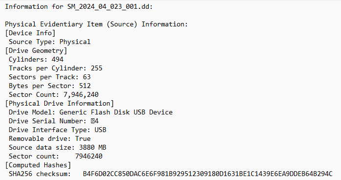

- **Second**, when multiple cluster size values produce equally valid mathematical results, forensic best practice requires the examiner to favor the value that reflects the device manufacturer's standard configuration. A USB drive of approximately 4 GB capacity, formatted with an 8192-byte cluster size, would be highly non-standard and is rarely seen in practice without deliberate manual intervention during formatting. No evidence of such intervention has been identified in this case. Therefore, 4096 bytes is the most consistent value with how a device of this type and capacity would be configured under normal conditions.

Both lines of reasoning independently point to the same conclusion, which increases confidence in the result.

#### b. A single independent JPEG file is present on the disk that has a clear relationship to the case. Carve the file, clearly describing the steps involved and the justification for any carving decisions you have taken. Include an image of the carved file.

The manual carving process of JPEG files was conducted using the HxD hexadecimal editor through the following sequential steps:

**Step 1: Potential Offsets Identification**

The full disk image was scanned using the Search All function in HxD for the standard JPEG header signature `FF D8 FF`. The scan returned many hits. To isolate independent files from embedded or fragmented assets, each result was evaluated against the following three criteria:

- The header begins at offset 00 of a 16-byte row in HxD, meaning it sits at the far left of the row. Because each row is exactly 16 bytes wide, any offset at position 00 is a multiple of 16, which is a necessary condition for cluster boundary alignment.
- The header offset is divisible by at least one standard potential cluster size, and in this case, at least four.
- The data preceding the header does not appear to be related to the data at or after it, typically indicated by a sequence of `00` or `FF` bytes, suggesting internal file slack or cluster/sector slack.

Applying these criteria, two independent JPEG candidates were identified:

**1. Offset 4726784**

All three criteria were satisfied:

- Offset 4726784 sits at position 00 of its 16-byte row in HxD.
- Cluster alignment check:

| File Starting Offset | Potential Cluster Size | = Offset / Cluster Size | Potential Match? |
|---|---|---|---|
| 4726784 | 512 | 9232 | Yes! (Whole number) |
| 4726784 | 1024 | 4616 | Yes! (Whole number) |
| 4726784 | 2048 | 2308 | Yes! (Whole number) |
| 4726784 | 4096 | 1154 | Yes! (Whole number) |

- The data preceding offset 4726784 consists of a continuous sequence of `FF FF FF FF` bytes, which are padding bytes unrelated to the JPEG data beginning at this point. This confirms the file starts independently here rather than being embedded within another file.


**2. Offset 3269828608**

Two out of three criteria were satisfied:

- Offset 3269828608 sits at position 00 of its 16-byte row in HxD.
- Cluster alignment check:

| File Starting Offset | Potential Cluster Size | = Offset / Cluster Size | Potential Match? |
|---|---|---|---|
| 4726784 | 512 | 9232 | Yes! (Whole number) |
| 4726784 | 1024 | 4616 | Yes! (Whole number) |
| 4726784 | 2048 | 2308 | Yes! (Whole number) |
| 4726784 | 4096 | 1154 | Yes! (Whole number) |

- The data preceding offset 3269828608 does not consist of clean `00` or `FF` padding bytes. Instead, it appears to be continuous data from a preceding block, meaning the third criterion could not be confirmed at this stage.

This offset was retained as a candidate because the first two criteria were satisfied. Its independence as a file was carried forward for confirmation at the footer validation stage in Step 3.

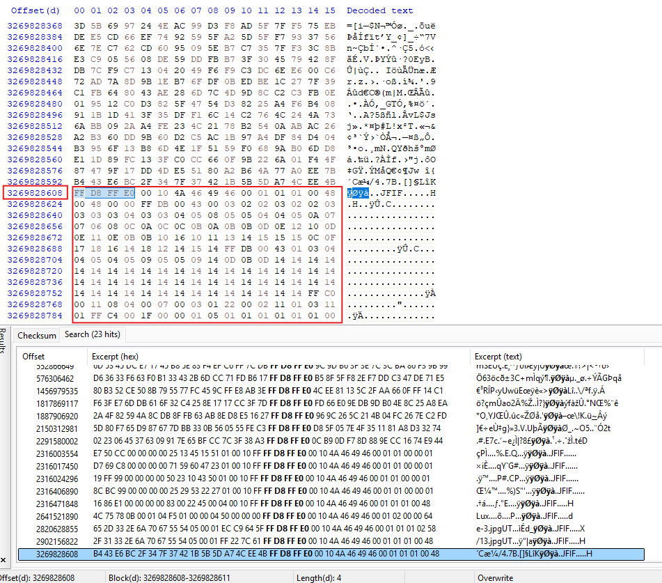

**Step 2: Locating the File Footer (End of File)**

To carve a complete and functional file, we have to determine its exact length by locating the file's footer. The footer acts as the definitive end-of-file marker; without it, the carved file would either be incomplete (causing structural rendering errors) or excessively large due to the inclusion of irrelevant unallocated data. Therefore, we use a search feature in HxD to find the standard JPEG End of Image (EOI) trailer, which is `FF D9`.

During a search for JPEG footers, multiple false `FF D9` hits were encountered, often caused by embedded thumbnails within the main image. To filter these out, contextual validation was required for each hit by inspecting the hex data immediately following it.

- **Header offset 4726784:** The search identified a valid footer at decimal offset 4736580. This specific offset was selected as the definitive end of file because a visual inspection of the hex data immediately following it revealed a continuous sequence of `00` bytes. These `00` sequences represent cluster slack space padding generated by the file system to fill the remainder of the cluster after the file data has concluded. The presence of this slack space confirms that the logical file terminated completely at offset 4736580.

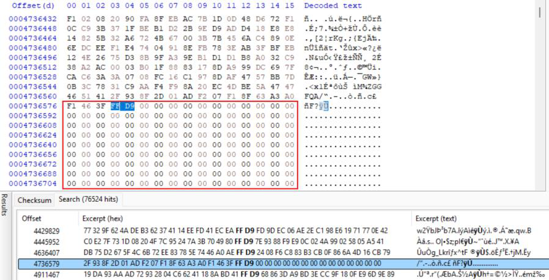

- **Header offset 3269828608:** The search identified a valid footer at decimal offset 3270618944. This specific offset was selected as the definitive end of file because a visual inspection of the hex data immediately following it revealed a continuous sequence of `00 00 00 00` bytes extending to the end of the cluster. As with Candidate A, these bytes represent cluster slack space padding, confirming that the logical file terminated completely at offset 3270618944. Additionally, the presence of this clean post-footer padding serves as retrospective confirmation that Candidate B is a truly independent file, solving the uncertainty noted in Step 1, where the data boundary criterion could not be fully satisfied at the header identification stage.

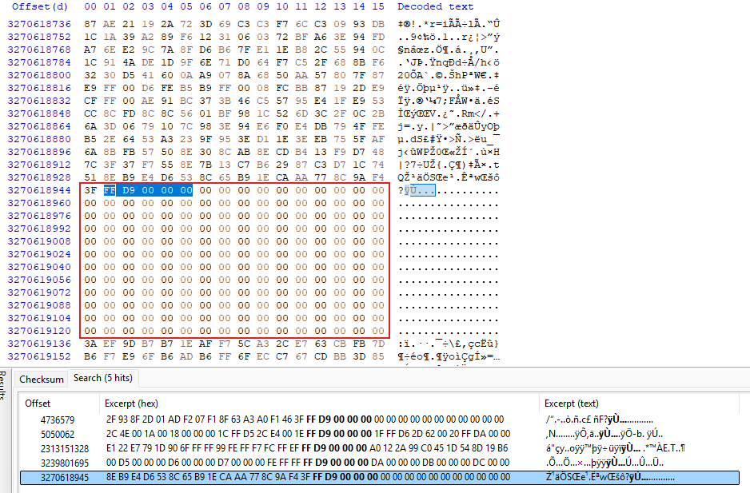

**Step 3: Selecting the Data Block**

To carve each candidate file, the bytes belonging to each file were isolated using the Select Block feature (Ctrl+E) in HxD. The parameters were set using the decimal (dec) radio button for both operations.

- **Candidate A (Offset 4726784 to 4736580):** The Start-offset was defined as 4726784, and the End-offset was defined as 4736580.

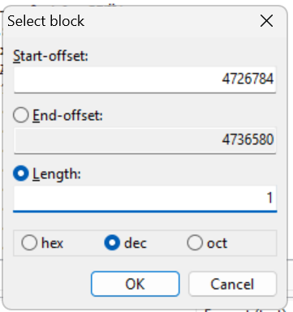

Having verified both the precise start and end points, the complete data block was isolated. Using the hex editor's block selection tool, the binary data from the start-offset (4726784) to the end-offset (4736580) was highlighted.

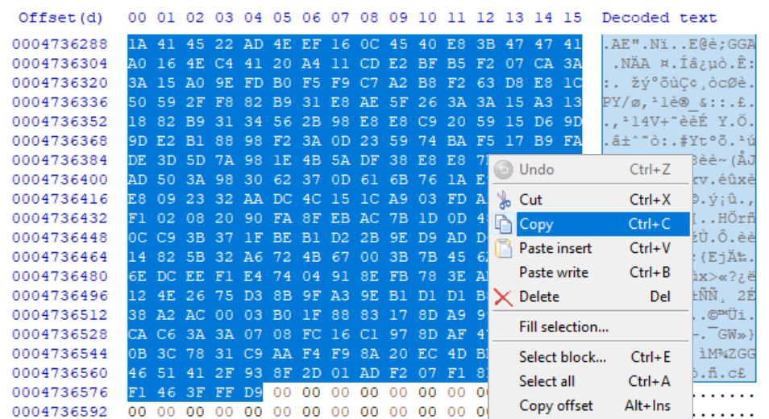

This selected contiguous block was then copied and pasted (Write) into a newly created binary file to avoid contaminating the original evidence. The new file was saved with a .jpg extension.

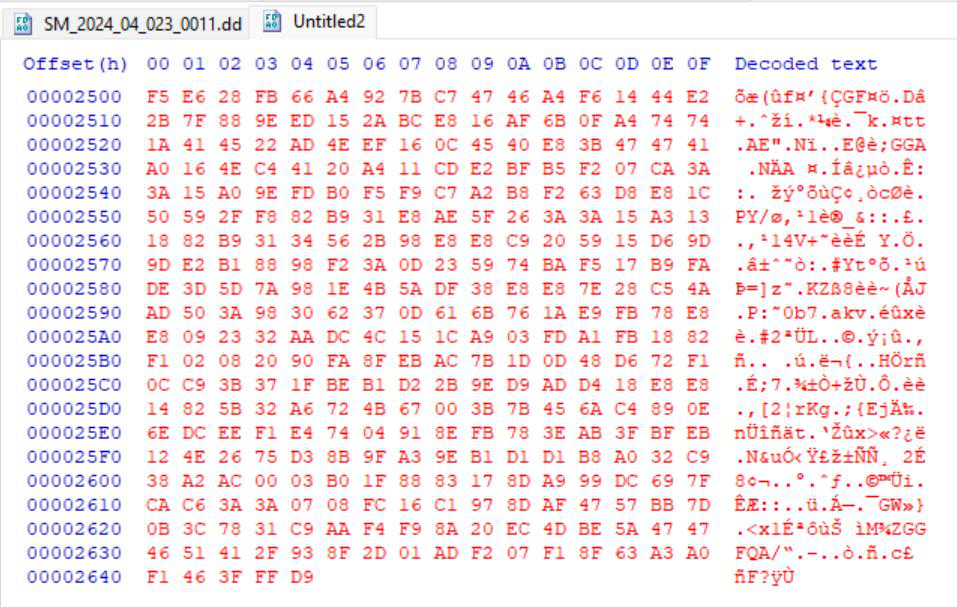

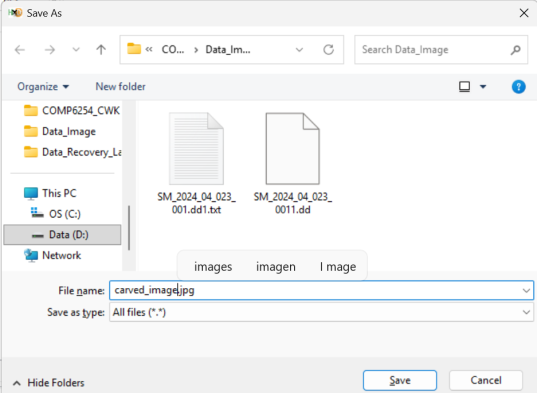

- **Candidate B (Offset 3269828608 to 3270618946):** The Start-offset was defined as 3269828608, and the End-offset was defined as 3270618946.

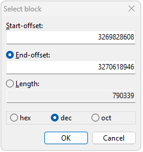

Having verified both the precise start and end points, the complete data block was isolated. Using the hex editor's block selection tool, the binary data from the start-offset (3269828608) to the end-offset (3270618944) was highlighted.

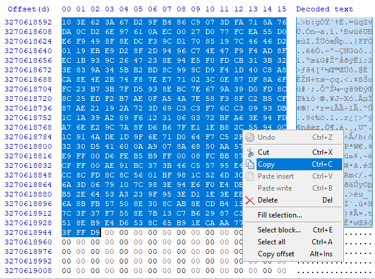

This selected contiguous block was then copied and pasted (Write) into a newly created binary file to avoid contaminating the original evidence. The new file was saved with a .jpg extension. The resulting file size is 790,339 bytes (approximately 772 KB).

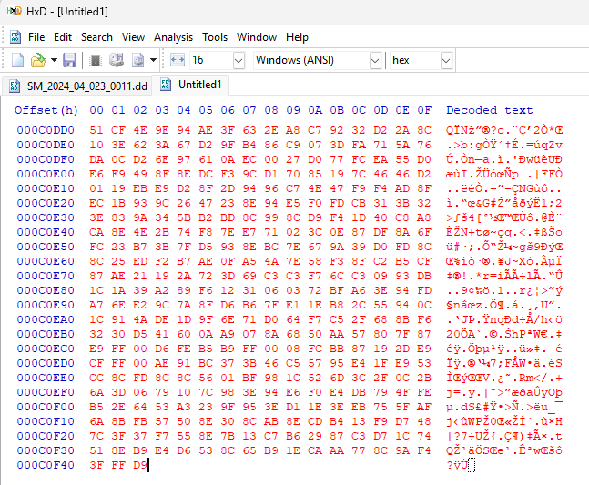

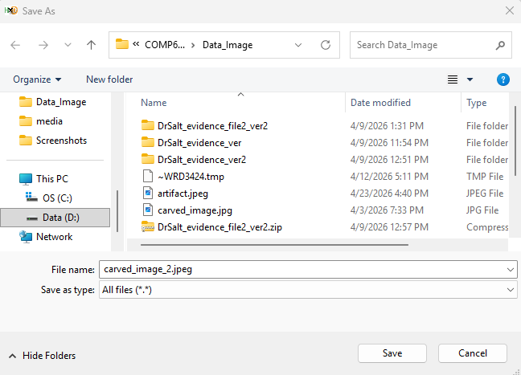

**Carving Image**


*Figure 1. carved_image.jpeg*


*Figure 2. carved_image_2.jpeg*

**Step 4: Relevance Assessment**

Following the successful carving of both candidate files, a relevance assessment was conducted to identify which file has a clear relationship to the case.

- **Candidate A (offset 4726784)** contains a photograph of a lion family in a natural outdoor environment. No connection could be established between this image and the circumstances of the case, which concerns the removal of pages from books across multiple bookshops in Cyberly. This file is therefore assessed as unrelated to the investigation.
- **Candidate B (offset 3269828608)** contains an AI-generated illustration depicting multiple library and bookshop interiors. This image has a direct and visible connection to the circumstances of the case, as the investigation concerns criminal damage committed across bookshops and libraries in Cyberly. The content of this image is consistent with the environment in which the alleged offences took place.

Candidate B (offset 3269828608) is, therefore, concluded to be the independent JPEG file, which has a clear relationship to this investigation and is presented below as the carved exhibit.

**Final Result:**


#### c. The device contains an OOXML file of interest to the investigation which contains an image of Dr Salt, along with additional document data. Use appropriate carving techniques to find and extract the appropriate OOXML file.


The target OOXML (DOCX) file was successfully identified and extracted using manual Data Carving techniques via a Hex editor (HxD). The file is located at **Start-Offset: 5160960** and **End-Offset: 210440344**. By employing a dual-extension examination strategy (converting to .docx for surface-level review and to .zip for core architectural analysis), the investigator recovered document data and extracted the true portrait of Dr. Salt.

Here is a breakdown of my investigation.

**Step 1: Signature Analysis and Data Carving**

The investigation commenced with scanning the entire drive to locate the binary signatures (Magic numbers) of an independent OOXML file format: `50 4B 03 04 14 00 06 00`. The scan results revealed two potential Start-offsets: 2855190528 and 5160960. A detailed analysis was conducted on both data blocks to authenticate the evidence.

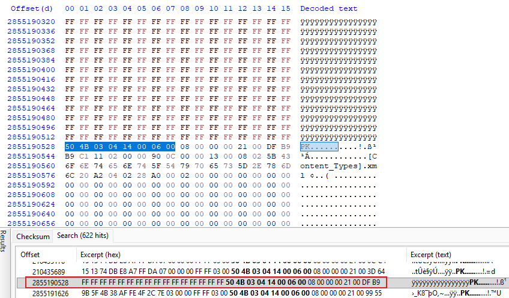

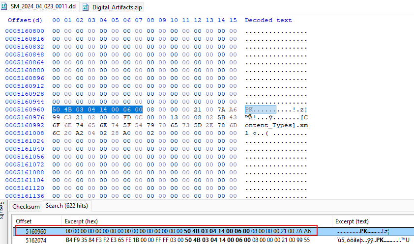

*Analysis of Potential File 1 (Start-offset: 2855190528)*

Scanning for the End of Central Directory (EOCD) signature `50 4B 05 06` for this Header returned multiple results. I analysed the binary structure and eliminated false candidates:

1. **Elimination of Offsets 2866402700 and 3239729261:** Both offsets were discarded because analysis confirmed they belong to unrelated archives. Specifically, the decoded text near offset 2866402700 reveals the filename "tox.ini", indicating this footer belongs to a Python development environment or source code backup. Similarly, the EOCD structure at offset 3239729261 declares 988 files (`DC 03 DC 03` in Little-Endian) alongside decoded HTML paths (e.g., /003997.html), proving it is a massive web backup archive rather than the target file.
2. **Selected Footer (Offset 2945624080):** The Hex code at this location contains a perfect EOCD structure `06 00 06 00` (declaring an archive with exactly 6 files). The resulting data block size is logical.

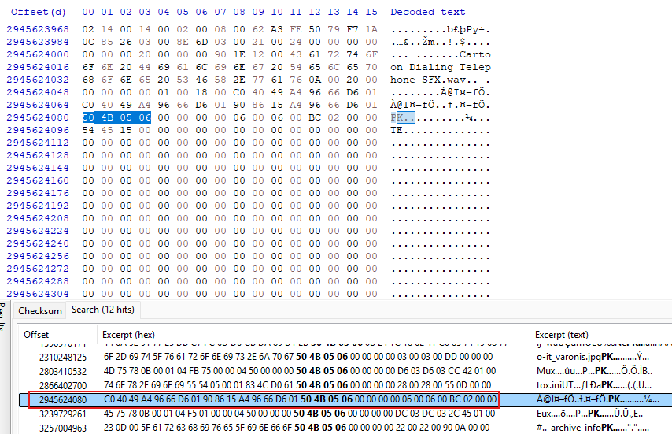

3. The end offset is calculated as: 2945624080 + 21 bytes = 2945624101.
4. **Carving Results & Exclusion:** The file was successfully carved. However, upon extraction, the root directory contained only 6 cartoon dialling telephone sound files (.wav), with no images or document data. This is a decoy file (Red Herring) intended to disrupt the investigation and was officially excluded.

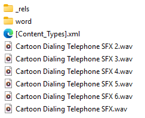

*Analysis of Potential File 2 (Start-offset: 5160960)*

Continuing the search for the EOCD signature `50 4B 05 06` for this Header, the investigator located the exact Footer at offset 210440323:

1. **Elimination of Offsets 185842060 and 186248610:** Analysis showed that the EOCDs at 185842060 and 186248610 belong to embedded files within the original document. The binary payload continues after these offsets.
2. **Basis for Selection:** This decision is supported by undeniable physical evidence from the binary structure. Immediately preceding the EOCD at offset 210440323 is the standard Office directory declaration string (`docProps/custom.xml`). Most importantly, right after this 22-byte EOCD block is a slack space consisting entirely of `00 00` (zero-out) bytes. This confirms that the file physically ended at this location on the drive cluster. Selecting earlier Footers would truncate the data and corrupt the archive structure.

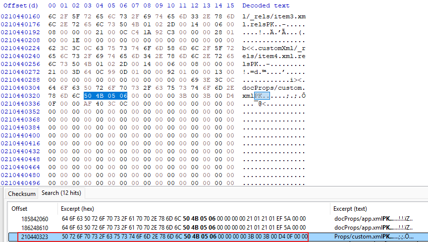

3. **Calculating End-offset:** 210440323 + 21 bytes = 210440344.
4. **Carving Results & Evaluation:** The carving process yielded a data block of approximately 180MB. Upon extraction, this data block is an intact OOXML document, containing extensive document data and many hidden image/media files. This content perfectly aligns with the investigation's objectives.
5. **Conclusion:** The data block from 5160960 to 210440344 is officially confirmed as the target OOXML file containing evidence regarding Dr. Salt.

**Step 2: Dual-Extension Examination**

Leveraging the fact that the OOXML format is essentially a compressed archive, the investigator altered the file extension of the extracted data block to serve two in-depth analytical purposes:

- **Conversion to .docx format (Surface Examination):** This operation allows Microsoft Word to compile the data block into a complete document. This helps quickly identify the document's cover (an academic report on libraries titled "Libraries: An essential part of local recovery") and trace the standard visible text data. The file opened and read successfully in Word without any errors, proving the carving extraction was perfect.
- **Conversion to .zip format (Deep Excavation):** Extracting the .zip file bypasses Word's graphical user interface, granting direct access to the core directory architecture. From here, I could excavate and extract information intentionally hidden within system directories like `word/media` and the source code file `word/document.xml`.

**Step 3: Identifying Dr. Salt's Portrait**

Observing the `word/media` directory within the .zip architecture revealed various media data, including 3 AI-generated portraits. The process of analysing and identifying the culprit's true portrait unfolded as follows:

**Overcoming Extension Spoofing:** Some image files were discovered to be intentionally disguised to evade detection and automated scanning tools. The investigator intervened and manually restored them to the standard .png format for analysis. (The remaining file, image13.png, was already in the standard format.)

Before Restore:


After Restore:


By cross-referencing the images with the B.Y.T.E Detective Agency website provided in the module content, we determined that image11.png and image12.png were actually images of the investigative agency's personnel (Detective Lord Pixelington and HR Manager Gloria Gigglesworth, respectively). The fact that the culprit disguised their file extensions and stored their photos proves they were secretly gathering information and conducting counter-surveillance on the investigative agency.


**Final Identification:** Through the process of elimination, the file image13.png (the blonde man wearing glasses) is confirmed to be the AI portrait of the culprit, Dr. Salt.


---

## Appendix B: OOXML Examination Exhibits

### A3: Task 2a, Document Timeline

**2.1 Exhibit B-1: docProps/core.xml**

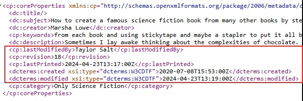

**2.2 Exhibit B-2: docProps/app.xml**

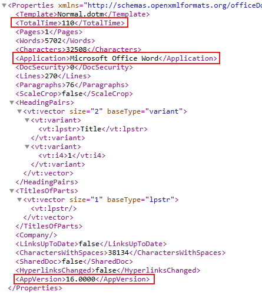

### A4: Task 2b, Linkage to Individual

**2.3 Exhibit B-3: docProps/core.xml**

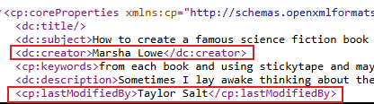

**2.4 Exhibit B-4: word/document.xml**

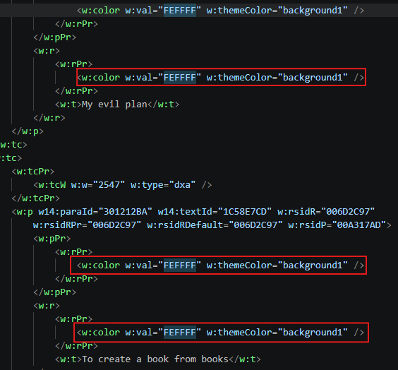

**2.5 Exhibit B-5: word/document.xml**


### A5: Task 2c, Further Information on Dr Salt

**2.6 Exhibit B-6: word/media/ directory**


**2.7 Exhibit B-7: image11.png**


**2.8 Exhibit B-8: image12.png**


**2.9 Exhibit B-9: image13.png**


**2.10 Exhibit B-10: B.Y.T.E Detective Agency website**


### A6: Task 2d, Insight into Motive

**2.11 Exhibit B-11: docProps/core.xml**

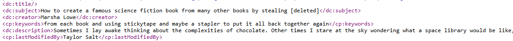

**2.12 Exhibit B-13: word/document.xml**


**2.13 Exhibit B-14: word/document.xml**

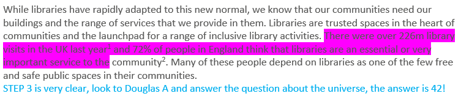

**2.14 Exhibit B-15: word/document.xml**


**2.15 Exhibit B-16: word/document.xml**


**2.16 Exhibit B-17: word/document.xml**

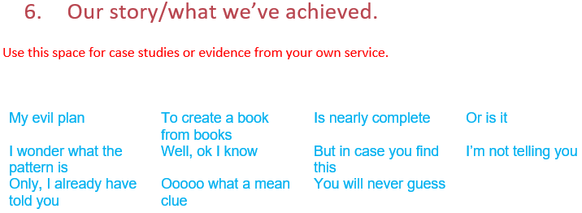

**2.17 Exhibit B-18: word/media/image1.png**

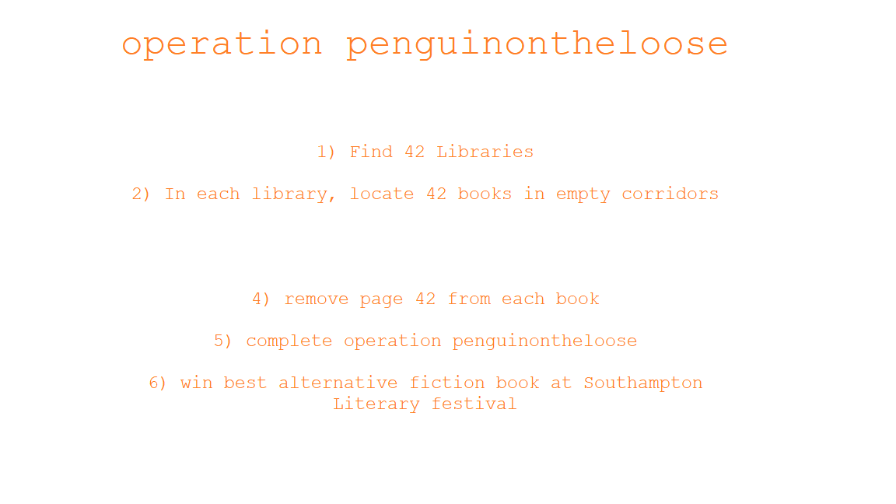

---

## Appendix C: Evidence Timeline Diagram

*Evidence Timeline Diagram, Operation Spoiler (CPD-2024-04-023)*

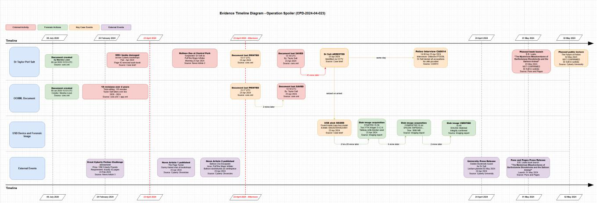

---

## Appendix D: Evidence Relationship Diagram

*Evidence Relationship Diagram, Operation Spoiler (CPD-2024-04-023)*

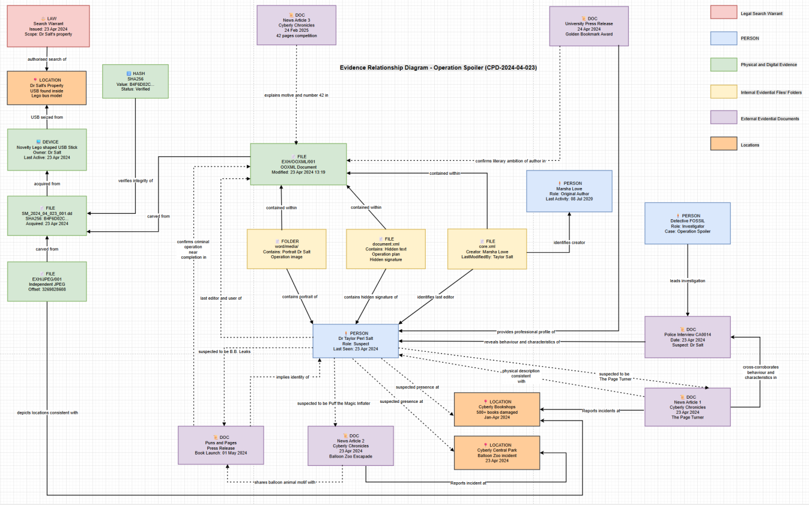
